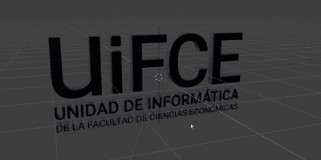

# Boletín UIFCE · Edición #1 · Noviembre 2026

¡Hola! Soy **Uifcito** 👋. Esto fue lo que aprendimos en la Facultad 👇

📺 [Ver en formato TV](edicion-01-tv.html)

---

## 01 · El Lanzamiento

### De las fórmulas a los tableros

*Lanzamiento Especial de Cursos Libres · 26 oct – 28 nov 2026*

| 3 cursos | 60 horas | 30 sesiones | 2 áreas |
|:---:|:---:|:---:|:---:|

| | Curso | Para qué te sirve | Nivel |
|:---:|---|---|---|
|  | **Excel Básico** | Fórmulas, tablas y gráficos para costos y finanzas | Inicial |
|  | **Programación en Python y R** | Programar desde cero, rumbo a la econometría | Intermedio |
|  | **Power BI Avanzado** | Tableros que cuentan historias y apoyan decisiones | Avanzado |

👉 [Conoce los cursos](https://cdiazsu-source.github.io/2026-2s-ET-OfertaCursosLibres/lanzamiento-especial.html)

 **Comparte tu certificado directo en LinkedIn.** Emítelo en el aplicativo y publícalo en tu perfil: [Ir al aplicativo →](https://fce.unal.edu.co/cursos-libres-uifce/)

### 🚀 Inicia tu ruta de área y complétala toda

`$ ruta --iniciar --completar`. Cada curso te prepara para el siguiente: de Inicial a Avanzado.

| Ruta | 01 · Inicial | 02 · Intermedio | 03 · Avanzado |
|---|---|---|---|
| **Análisis de Datos y BI** | Excel Básico | Inteligencia de Negocios | Power BI Avanzado |
| **Programación y Ciencia de Datos** | Lógica de Programación | Python y R | Machine Learning |

👉 [Ver las 6 rutas](https://cdiazsu-source.github.io/2026-2s-ET-OfertaCursosLibres/mapa-rutas.html)

---

## 02 · Caja de Herramientas

### Software que se vuelve habilidad

*Apoyos Académicos: sesiones guiadas dentro de tu asignatura*

| | Habilidad | En una frase | Claves |
|:---:|---|---|---|
|  | 💼 **Gestión empresarial** | Entiende cómo funciona una empresa por dentro | 12 módulos · ERP · [Ver ficha](https://cdiazsu-source.github.io/2026-2s-ET-ApoyosAcademicos/catalogo.html#Gesti%C3%B3n%20y%20sistemas%20empresariales) |
|  | 🗺️ **Análisis geoespacial** | Pon tus datos en el mapa | Mapas · Territorio · [Ver ficha](https://cdiazsu-source.github.io/2026-2s-ET-ApoyosAcademicos/catalogo.html#Investigaci%C3%B3n%20y%20escritura%20acad%C3%A9mica) |
|  | 📊 **Contabilidad y finanzas** | De la teoría contable a la factura real | Facturación · Reportes · [Ver ficha](https://cdiazsu-source.github.io/2026-2s-ET-ApoyosAcademicos/catalogo.html#Gesti%C3%B3n%20y%20sistemas%20empresariales) |

---

## 03 · Tip de Virtualización

<!-- ✏️ ESPACIO EDITABLE: cambia título y texto del tip en cada edición -->
 **Todas tus entregas en un solo lugar:** Moodle → **Área personal** → **Línea de tiempo**.
<!-- ✏️ FIN DEL ESPACIO EDITABLE -->

---

### ¿Tienes alguna pregunta?

Comunícate con nosotros, con gusto te ayudamos.

- ✉️ [uniic_bog@unal.edu.co](mailto:uniic_bog@unal.edu.co)
- 📞 3165000 Ext. 12301
- 📍 Edificio 310 · UIFCE

*UIFCE · Facultad de Ciencias Económicas · Universidad Nacional de Colombia, sede Bogotá*
[Cursos Libres](https://cdiazsu-source.github.io/2026-2s-ET-OfertaCursosLibres/) · [Apoyos Académicos](https://cdiazsu-source.github.io/2026-2s-ET-ApoyosAcademicos/)
