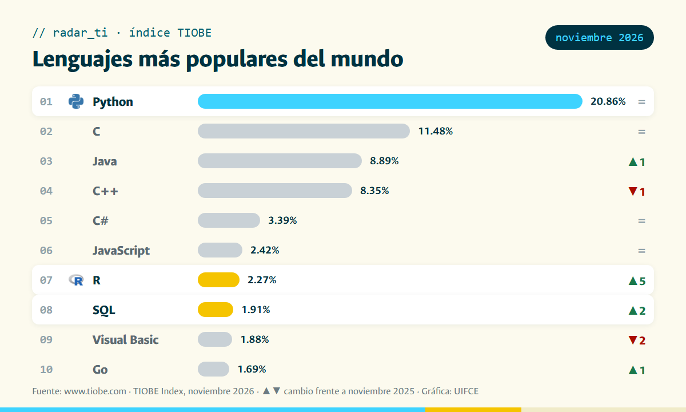

# Boletín UIFCE · Edición #1 · Noviembre 2026

*Lanzamiento Especial / Ruta de área / Certificado en LinkedIn / SAP · QGIS · Siigo / 4 tips de Moodle / Radar TI: TIOBE, Microsoft 365 y Nvidia*

 ¡Hola! Soy **Uifcito** 👋. Esto fue lo que aprendimos en la Facultad.

📺 [Ver en formato TV](edicion-01-tv.html) · 📱 [Versión Instagram](edicion-01-ig.html)

---

## 01 / Cursos Libres

### De las fórmulas a los tableros
   

*Lanzamiento Especial · 26 oct – 28 nov 2026*

Excel Básico, Programación en Python y R, y Power BI Avanzado: tres cursos para analizar datos y contarlos con tableros.
**3 cursos · 60 horas · 30 sesiones**

👉 [Conoce los cursos](https://cdiazsu-source.github.io/2026-2s-ET-OfertaCursosLibres/lanzamiento-especial.html)

### Inicia tu ruta de área y complétala toda

Cada curso te prepara para el siguiente, de Inicial a Avanzado.

| Ruta | 01 · Inicial | 02 · Intermedio | 03 · Avanzado |
|---|---|---|---|
| **Análisis de Datos y BI** | Excel Básico | Inteligencia de Negocios | Power BI Avanzado |
| **Programación y Ciencia de Datos** | Lógica de Programación | Python y R | Machine Learning |

👉 [Ver las 6 rutas](https://cdiazsu-source.github.io/2026-2s-ET-OfertaCursosLibres/mapa-rutas.html)

###  Comparte tu certificado directo en LinkedIn

Emítelo en el aplicativo con tu correo institucional y publícalo en tu perfil profesional.
👉 [Ir al aplicativo](https://fce.unal.edu.co/cursos-libres-uifce/)

---

## 02 / Apoyos Académicos · Caja de Herramientas

###  SAP: entiende cómo funciona una empresa por dentro
*💼 Gestión empresarial.* El ERP líder en un recorrido por 12 módulos: finanzas, logística, costos y capital humano.
[Ver la ficha →](https://cdiazsu-source.github.io/2026-2s-ET-ApoyosAcademicos/catalogo.html#Gesti%C3%B3n%20y%20sistemas%20empresariales)

###  QGIS: pon tus datos en el mapa
*🗺️ Análisis geoespacial.* Mapas, exploración de territorios y croquis para proyectos urbanos y territoriales.
[Ver la ficha →](https://cdiazsu-source.github.io/2026-2s-ET-ApoyosAcademicos/catalogo.html#Investigaci%C3%B3n%20y%20escritura%20acad%C3%A9mica)

###  Siigo: de la teoría contable a la factura real
*📊 Contabilidad y finanzas.* Facturación, reportes financieros y certificados contables en una interfaz sencilla.
[Ver la ficha →](https://cdiazsu-source.github.io/2026-2s-ET-ApoyosAcademicos/catalogo.html#Gesti%C3%B3n%20y%20sistemas%20empresariales)

---

## 03 / Aulas Virtuales · Moodle sin enredos

<!-- ✏️ ESPACIO EDITABLE: cambia los tips de Moodle en cada edición -->
 **4 ajustes de 2 minutos para tus aulas virtuales.** Organiza tus entregas antes de que se acumulen.

| # | Ajuste | Dónde | Para qué |
|:---:|---|---|---|
| 1 | **Todas tus entregas en un solo lugar** | `Área personal → Línea de tiempo` | Filtra por *Próximos 7 días* o *Vencidas* y ordénalas por fecha o por curso. |
| 2 | **Tus fechas, en el calendario del celular** | `Calendario → Importar o exportar calendarios → Exportar` | Copia la URL y pégala en Google Calendar: las entregas aparecen solas. |
| 3 | **Que el aviso te llegue al correo** | `Menú de usuario → Preferencias → Preferencias de notificación` | Activa el correo para tareas y foros, y no te pierdas una fecha. |
| 4 | **Tu aula en el bolsillo** | `App Moodle (Android / iOS)` | Revisa material, entrega tareas y descarga contenido para verlo sin conexión. |

Los nombres de los menús pueden variar un poco según la versión de Moodle de tu aula.
<!-- ✏️ FIN DEL ESPACIO EDITABLE -->

---

## 04 / Radar TI · Noticias del mundo

### R entra al Top 10 de los lenguajes más populares del mundo
*Índice TIOBE · noviembre 2026*

R sube del puesto 12 al 7, SQL pasa al 8 y Python sigue en el n.º 1 con 20,86 %. Son justo los lenguajes que trabajas en la ruta de Programación y Ciencia de Datos.
👉 [Ver el índice completo](https://www.tiobe.com/tiobe-index/)

Fuente: www.tiobe.com · Gráfica elaborada por la UIFCE con datos del TIOBE Index.

### Microsoft 365 estuvo caído más de 24 horas
*Nube · 12 nov 2026*

Outlook, Teams, Copilot y SharePoint fallaron en todo el mundo. Microsoft lo atribuyó a sus servidores de puerta de enlace de red y descartó un ciberataque. 💡 **Lección:** guarda copias locales de lo importante y ten un canal alterno.
👉 [Leer la noticia](https://www.bleepingcomputer.com/news/microsoft/massive-microsoft-365-outage-disrupts-outlook-teams-copilot-worldwide/)

Fuentes: Microsoft (aviso MO1550821), BleepingComputer, Al Jazeera. <!-- ✏️ CRÉDITO FOTO MICROSOFT -->Foto: El Tiempo (recortada).

### Nvidia cambia de CEO: Colette Kress asume de forma interina
*Industria · 12 nov 2026*

Jensen Huang, cofundador de la empresa de chips que impulsa la IA, dejó sus cargos de presidente, CEO y miembro de la junta. Kress seguirá también como directora financiera mientras se elige un reemplazo.
👉 [Leer la noticia](https://www.cnn.com/2026/11/12/tech/jensen-huang-nvidia-resigns)

Fuentes: Nvidia, Form 8-K ante la SEC; CNBC; CNN. <!-- ✏️ CRÉDITO FOTO NVIDIA -->Foto: El Tiempo (recortada).

---

### ¿Tienes alguna pregunta?

Comunícate con nosotros, con gusto te ayudamos.

- ✉️ [uniic_bog@unal.edu.co](mailto:uniic_bog@unal.edu.co)
- 📞 3165000 Ext. 12301
- 📍 Edificio 310 · UIFCE

*UIFCE · Facultad de Ciencias Económicas · Universidad Nacional de Colombia, sede Bogotá*
[Cursos Libres](https://cdiazsu-source.github.io/2026-2s-ET-OfertaCursosLibres/) · [Apoyos Académicos](https://cdiazsu-source.github.io/2026-2s-ET-ApoyosAcademicos/)
